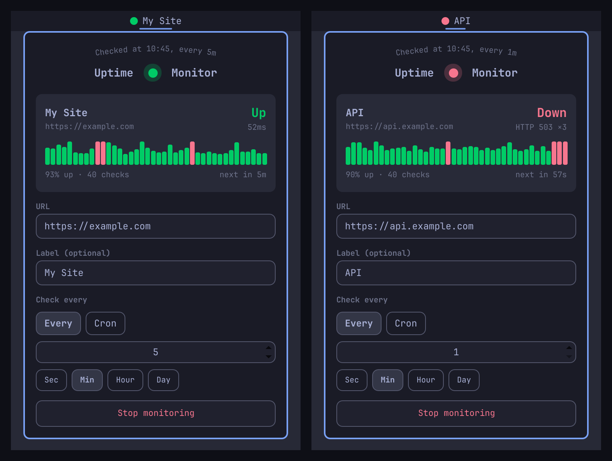

# Uptime Monitor

Monitor a single URL from the Omarchy bar. Green dot when the site is up, red when it's down. Click for the details and a graph of the recent checks.



## Install

```sh
omarchy plugin add https://github.com/SjoenH/omarchy-uptime-monitor.git --enable
```

## Usage

- A colored dot appears in the bar: **green** = up, **red** = down, **grey** = checking or not monitoring
- Hover for a quick status tooltip (URL + state + check cadence)
- Click to open the panel:
  - **The status card** shows Up or Down, the response time or the reason it is down (`HTTP 503`, `Timeout`, `Connection failed`), and a graph of the last 40 checks. Each bar is one check and is as tall as its response time; a failed check is a full-height red bar. Below the graph: the share of those checks that were up, and the time until the next one.
  - **URL** is the address to probe. The scheme is optional; `https://` is added if omitted.
  - **Label** (optional) is shown next to the dot in the bar
  - **Check every** is either a simple interval (number + unit) or a five-field cron expression
  - **Stop monitoring** stops the checks and clears the dot. The URL stays in the field, and the same button starts it again.
- The URL and label apply when you press Enter or close the panel; schedule changes apply immediately
- The first check runs as soon as a URL is set

A response with a 2xx or 3xx status counts as up. Redirects are not followed.

The URL, label, and schedule persist across restarts via `shell.json`. The check history is kept in memory only: it starts empty when the shell starts and is cleared when the URL changes.

## Default

Ships unmonitored. Enter a URL in the panel to start; it checks every 30 seconds by default.

## Requirements

`curl`, which Omarchy ships with. Each check is one request to the URL you entered; nothing else is contacted.

## Remove

```sh
omarchy plugin remove no.koka.uptime-monitor
```

## Development

The spec runs against the real widget and panel, with the installed Omarchy UI kit, in a headless Quickshell. It probes a local server it starts itself, so no real site and no `shell.json` is touched:

```sh
tests/run.sh
```

## Credits

- Panel layout after Omarchy's world clock
- By [koka.no](https://koka.no)

## License

MIT License - See LICENSE file for details
